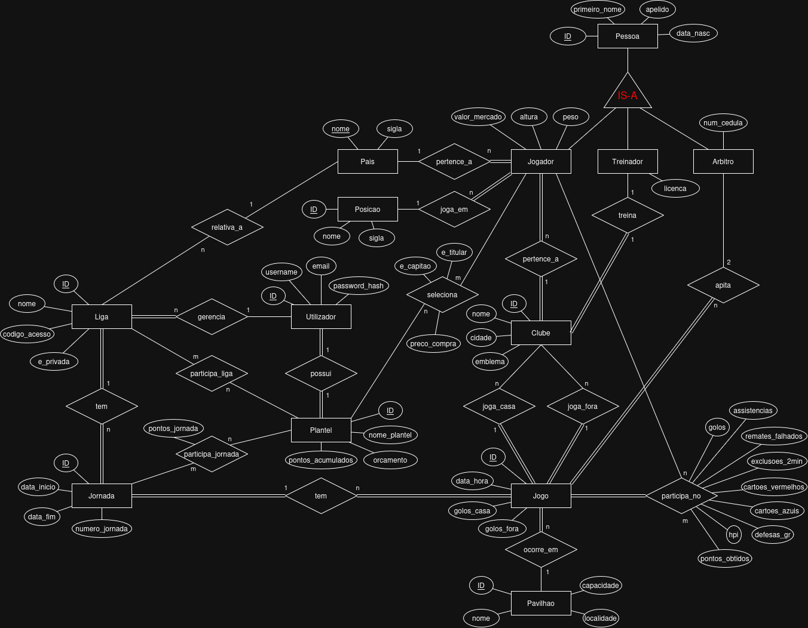
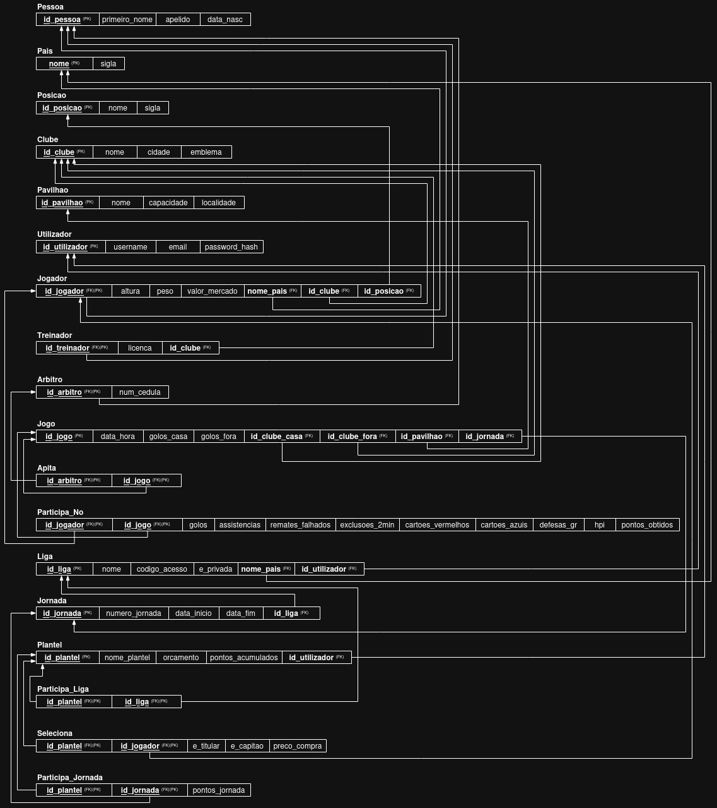

# BD: Trabalho Prático APFE

**Grupo**: P3G2
- João Reis, MEC: 132982
- Rúben Marques, MEC: 133155

## Introdução / Introduction
 
Este projeto consiste no desenvolvimento da base de dados para uma plataforma de Fantasy Handball. A ideia principal é permitir que qualquer utilizador crie ou entre em ligas virtuais e monte o seu próprio plantel com jogadores reais de andebol. Planeamos que a pontuação de cada plantel seja calculada dependendo do desempenho verdadeiro dos atletas em cada jogo e jornada da vida real (Se necessário iremos adicionar dados fictícios para manter coerência com o diagrama e esquema, ou se acharmos necessário ao longo do projeto).

## ​Análise de Requisitos / Requirements

Ao criar as entidades existentes numa Fantasy percebemos que iriam haver entidades que representariam coisas reais e outras que representariam coisas virtuais, criadas por um utilizador ou calculadas através dos dados reais.

Para as entidades reais, começámos a definir as pessoas, e como todas as pessoas iam ter coisas em comum, decidimos usar uma herança IS-A para jogadores, treinadores e árbitros, que por sua vez vão ter os seus atributos e relações próprios.
Passando para os jogos, que é uma das entidades mais importantes pois é a que envolve mais interações, escolhemos associar as estatísticas dos jogadores aos jogos, pois temos dados por jogador mas mais à frente para cada jornada iremos precisar destas mesma estatística por jogo para cada jogador. Assim esta relação irá ter os atributos que registam o que cada jogador faz em cada partida. 
Tivemos ainda atenção à relação entre clubes e jogos, pois num jogo é obrigatório 2 equipas, 1 visitante e 1 visitada.
Ainda temos algumas entidades para paises, posições e pavilhões, que apesar de serem mais secundárias, foram feitas com a ideia de complementar algumas ações possíveis que um utilizador poderá querer fazer relativamente à sua liga ou plantel.

Para as entidades virtuais, pensamos da perspetiva do utilizador, pois ele vai controlar tudo. Cada utilizador registado pode ter o seu próprio plantel, e em cada plantel precisamos saber o preço de compra a partir do preço atual do jogador, quem é titular e não titular (suplente), e quem é capitao. Isto irá servir para calcular os pontos nas jornadas.
O mesmo plantel pode competir em várias ligas ao mesmo tempo, quer sejam públicas ou privadas criadas entre amigos. Além disso, em vez de guardarmos apenas o total acumulado de pontos que vai subindo ao longo da liga, decidimos guardar os pontos por jornada. Desta forma, o utilizador consegue acompanhar o seu histórico, e usamos as jornadas para calcular os pontos na liga. 
Uma liga pode também ser relativa a uma país, mas já é opcional.

## DER

## ER

