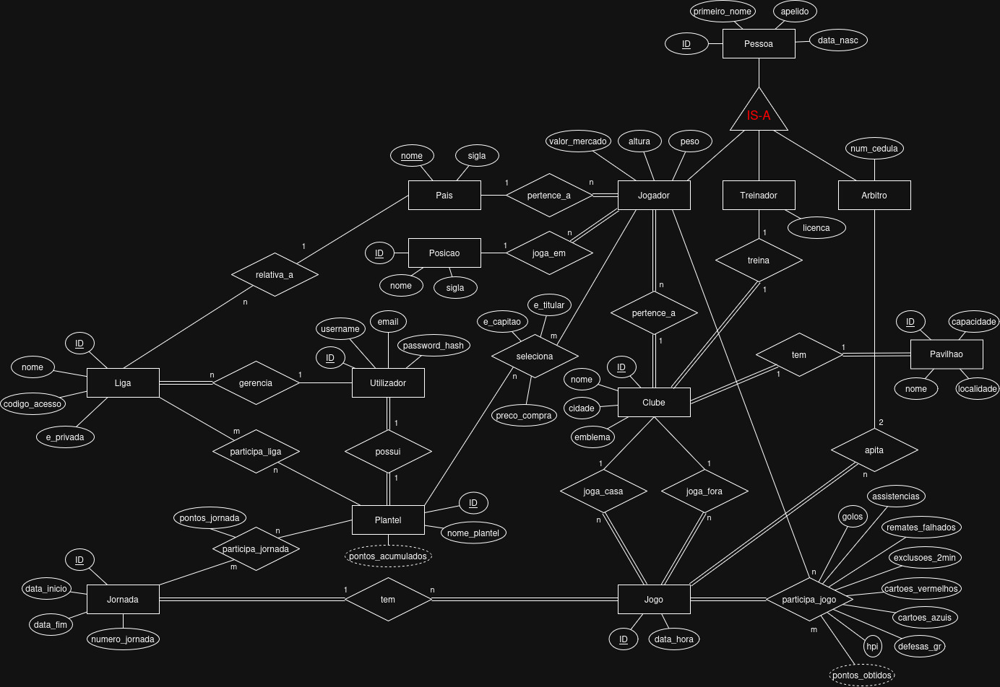
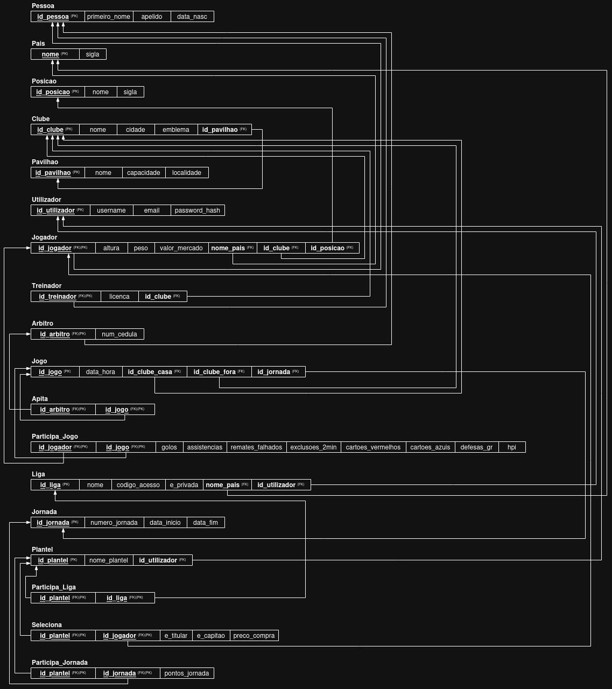

# BD: Trabalho Prático APF-T

**Grupo**: P3G2
- João Reis, MEC: 132982
- Rúben Marques, MEC: 133155

## Introdução / Introduction
 
Este projeto consiste no desenvolvimento da base de dados para uma plataforma de Fantasy Handball. A ideia principal é permitir que qualquer utilizador crie ou entre em ligas virtuais e monte o seu próprio plantel com jogadores reais de andebol. Planeamos que a pontuação de cada plantel seja calculada dependendo do desempenho verdadeiro dos atletas em cada jogo e jornada da vida real (Se necessário iremos adicionar dados fictícios para manter coerência com o diagrama e esquema, ou se acharmos necessário ao longo do projeto).

## ​Análise de Requisitos / Requirements

Ao criar as entidades existentes numa Fantasy percebemos que iriam haver entidades que representariam coisas reais e outras que representariam coisas virtuais, criadas por um utilizador ou calculadas através dos dados reais.

Para as entidades reais, começámos a definir as pessoas, e como todas as pessoas iam ter coisas em comum, decidimos usar uma herança IS-A para jogadores, treinadores e árbitros, que por sua vez vão ter os seus atributos e relações próprias.
Passando para os jogos, que é uma das entidades mais importantes pois é a que envolve mais interações, escolhemos associar as estatísticas dos jogadores aos jogos, pois temos dados por jogador mas mais à frente para cada jornada iremos precisar destas mesma estatística por jogo para cada jogador. Assim esta relação irá ter os atributos que registam o que cada jogador faz em cada partida. 
Tivemos ainda atenção à relação entre clubes e jogos, pois num jogo é obrigatório 2 equipas, 1 visitante e 1 visitada.
Ainda temos algumas entidades para paises, posições e pavilhões, que apesar de serem mais secundárias, foram feitas com a ideia de complementar algumas ações possíveis que um utilizador poderá querer fazer relativamente à sua liga ou plantel.

Para as entidades virtuais, pensamos da perspetiva do utilizador, pois ele vai controlar tudo. Cada utilizador registado pode ter o seu próprio plantel, e em cada plantel precisamos saber o preço de compra a partir do preço atual do jogador, quem é titular e não titular (suplente), e quem é capitao. Isto irá servir para calcular os pontos nas jornadas.
O mesmo plantel pode competir em várias ligas ao mesmo tempo, quer sejam públicas ou privadas criadas entre amigos. Além disso, em vez de guardarmos o total acumulado de pontos (que é um atributo derivado), decidimos guardar apenas os pontos por jornada. Desta forma, o utilizador consegue acompanhar o seu histórico e calculamos dinamicamente os pontos acumulados na liga.
Uma liga pode também ser relativa a uma país, mas já é opcional.

## DER - Diagrama Entidade Relacionamento/Entity Relationship Diagram

### Versão final/Final version

## ER - Esquema Relacional/Relational Schema

### Versão final/Final Version

## ​SQL DDL - Data Definition Language

[SQL DDL File](sql/01_ddl.sql "SQLFileQuestion")

O `01_ddl.sql` e o `04_db_init.sql` contêm o esquema e os dados iniciais. A normalização é aplicada pelo script [`sql/normalizacao.sql`](sql/normalizacao.sql), que se executa a seguir a esses dois e leva a base de dados ao esquema final representado no ER:

`01_ddl.sql` → `04_db_init.sql` → `normalizacao.sql`

## Normalização / Normalization

Após a definição do esquema inicial (`DDL` e `DML`), procedeu-se à análise e normalização da base de dados com o objetivo de atingir a Terceira Forma Normal (3FN), eliminar redundâncias e reforçar a integridade dos dados. O DER e o ER foram atualizados e o script `sql/normalizacao.sql` aplica à base de dados as mesmas alterações.

### 1. Análise de dependências funcionais

As dependências funcionais (DF) foram definidas a partir da semântica dos atributos (e não inferidas dos dados). A **1FN** é cumprida em todas as relações (atributos atómicos, sem relações aninhadas). A **2FN** é cumprida em todas: nas 5 relações de chave composta (`participa_liga`, `seleciona`, `participa_jornada`, `apita`, `participa_jogo`) todos os atributos não-chave dependem da chave completa.

Esquema final (após normalização):

| Relação | Chave(s) | DF principais | Forma normal |
|---|---|---|---|
| pessoa | id_pessoa | id_pessoa → primeiro_nome, apelido, data_nasc | BCNF |
| pais | nome; sigla | nome ↔ sigla | BCNF |
| posicao | id_posicao; nome; sigla | id_posicao → nome, sigla | BCNF |
| clube | id_clube; nome; id_pavilhao | id_clube → nome, cidade, emblema, id_pavilhao | BCNF |
| pavilhao | id_pavilhao; nome | id_pavilhao → nome, capacidade, localidade | BCNF |
| utilizador | id_utilizador; username; email | id_utilizador → username, email, password_hash | BCNF |
| jogador | id_jogador | id_jogador → altura, peso, valor_mercado, nome_pais, id_clube, id_posicao | BCNF |
| treinador | id_treinador; id_clube | id_treinador → licenca, id_clube | BCNF |
| arbitro | id_arbitro; num_cedula | id_arbitro → num_cedula | BCNF |
| liga | id_liga | id_liga → nome, codigo_acesso, e_privada, nome_pais, id_utilizador | BCNF |
| plantel | id_plantel; id_utilizador | id_plantel → nome_plantel, id_utilizador | BCNF |
| jornada | id_jornada; numero_jornada | id_jornada → numero_jornada, data_inicio, data_fim | BCNF |
| jogo | id_jogo | id_jogo → data_hora, id_clube_casa, id_clube_fora, id_jornada | BCNF |
| participa_liga, apita | (chave composta) | sem atributos fora da chave | BCNF |
| seleciona | (id_plantel, id_jogador) | → e_titular, e_capitao, preco_compra | BCNF |
| participa_jornada | (id_plantel, id_jornada) | → pontos_jornada | BCNF |
| participa_jogo | (id_jogador, id_jogo) | → golos, assistencias, remates_falhados, exclusoes_2min, cartoes_vermelhos, cartoes_azuis, defesas_gr, hpi | BCNF |

Critérios informais (BD8): cada relação tem uma semântica única; os poucos atributos opcionais (`liga.codigo_acesso`, `liga.nome_pais`, `clube.emblema`, `jogador.altura`, `jogador.peso`) são NULL por regra de negócio (liga pública, liga sem país, dados em falta) e não justificam relações separadas; todas as junções fazem-se por PK/FK.

### 2. Violações encontradas e correções

**Violação formal da 3FN**

* **`Participa_Jogo.pontos_obtidos`:** existe a dependência {golos, assistencias, remates_falhados, exclusoes_2min, cartoes_vermelhos, cartoes_azuis, defesas_gr, hpi} → pontos_obtidos entre atributos não-chave (dependência transitiva). Como a dependência é uma fórmula e não uma tabela de consulta, a decomposição não faz sentido: o atributo foi removido e os pontos passam a ser calculados a partir das estatísticas.
* **`Jogo.id_pavilhao` (`Jogo` → `Clube` → `Pavilhao`):** assumimos a regra de negócio de que todos os jogos se disputam no pavilhão do clube visitado, ou seja, `id_clube_casa → id_pavilhao` (não há jogos em campo neutro). Existe assim dependência transitiva, pelo que `id_pavilhao` passou para `Clube` (relação 1:1 com `Pavilhao`, com `UNIQUE`). Cada clube joga no pavilhão da sua cidade, o que se confirma em todos os jogos em casa.

**Atributos derivados (redundância; não são violações formais da 3FN)**

* **`Plantel.pontos_acumulados`:** soma de `pontos_jornada` de `Participa_Jornada`. Removido; calcula-se por `SUM`.
* **`Plantel.orcamento`:** igual ao orçamento inicial da plataforma (100 000 000) menos a soma dos `preco_compra` do plantel. Removido.
* **`Jogo.golos_casa` e `Jogo.golos_fora`:** soma dos golos individuais dos jogadores de cada clube em `Participa_Jogo`. Removidos.

**Atributos que se mantêm guardados (redundância deliberada)**

* **`Participa_Jornada.pontos_jornada`:** é derivável (titulares e capitão do plantel × pontos dos jogos da jornada), mas mantém-se guardado como *snapshot*: a relação `Seleciona` não tem dimensão "jornada", pelo que, se o valor fosse calculado a pedido, trocar um titular depois de uma jornada alteraria retroativamente o histórico. Esta decisão enquadra-se no ponto de equilíbrio entre 3FN e BCNF do BD8.
* **`Seleciona.preco_compra`:** não é redundante; guarda o preço no momento da compra, que difere do `valor_mercado` atual.

**Desacoplamento entre `Jornada` e `Liga`:** as jornadas correspondem ao calendário real e um plantel pode competir em várias ligas, pelo que se removeu `id_liga` de `Jornada` (que só permitia jornadas e jogos para uma liga). A ligação passa a ser feita por `Participa_Jornada` e `Participa_Liga`, e `numero_jornada` passou a `UNIQUE`.

### 3. O que faz o script `normalizacao.sql`

Por ordem:

1. **Pavilhão:** acrescenta `clube.id_pavilhao` (com `UNIQUE` e chave estrangeira), confirma que coincide com o pavilhão dos jogos em casa e remove `jogo.id_pavilhao`.
2. **Jornada:** remove `jornada.id_liga` e acrescenta `UNIQUE (numero_jornada)`.
3. **Pontos de jornada:** recalcula `participa_jornada.pontos_jornada` (titulares, capitão a dobrar). Os valores do povoamento inicial não correspondiam às estatísticas: nenhum dos 4 plantéis tinha `pontos_acumulados` igual à soma das suas jornadas.
4. **Derivados:** remove `plantel.orcamento`, `plantel.pontos_acumulados`, `jogo.golos_casa`, `jogo.golos_fora` e `participa_jogo.pontos_obtidos` (incluindo as restrições `DEFAULT` e `CHECK` associadas).
5. **Restrições:** as listadas na secção seguinte.

Com a remoção de `golos_casa` e `golos_fora`, o resultado de cada jogo passa a ser a soma dos golos individuais, que é a única fonte de verdade. Os resultados do povoamento inicial eram dados de teste incoerentes com essas estatísticas (em 22 dos 45 jogos o vencedor seria diferente), pelo que não se preservam.

### 4. Restrições de integridade acrescentadas

* **Chaves candidatas (`UNIQUE`):** `pais.sigla`, `posicao.nome`, `posicao.sigla`, `clube.nome`, `pavilhao.nome`, `treinador.id_clube` e `clube.id_pavilhao` (relações 1:1 do DER).
* **`CHECK` e índices filtrados:** liga privada ⇔ tem `codigo_acesso` (e código único); capitão tem de ser titular; no máximo um capitão por plantel; no máximo 1 cartão vermelho e 1 azul por jogador e jogo.

### 5. Regras assumidas

* Pontos de um jogador num jogo: 4×golos + 2×assistências − 1×remates falhados − 2×exclusões de 2 min − 5×cartão vermelho − 3×cartão azul + 3×defesas de GR + 0,1×HPI, arredondados a 2 casas; o capitão vale o dobro. O peso do cartão azul foi definido pelo grupo (os dados não têm cartões azuis).
* O orçamento restante de um plantel é o orçamento inicial menos a soma dos `preco_compra`; assume-se que vender um jogador devolve o preço de compra.
* Os golos de um jogo atribuem-se pelo clube atual do jogador; assume-se que não há transferências durante a época.